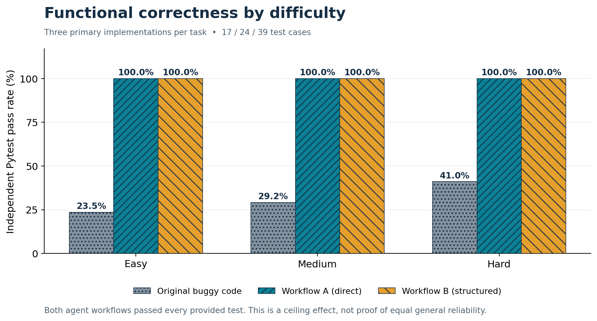
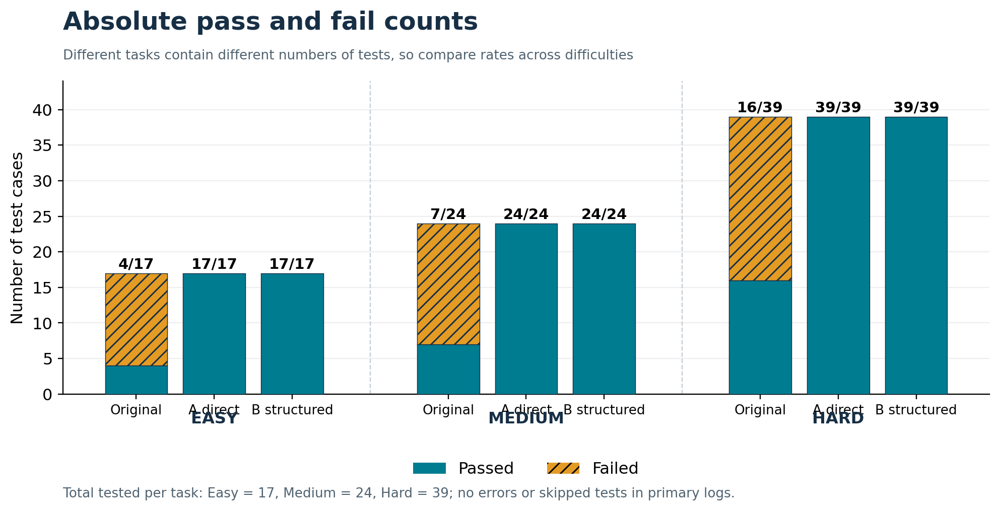
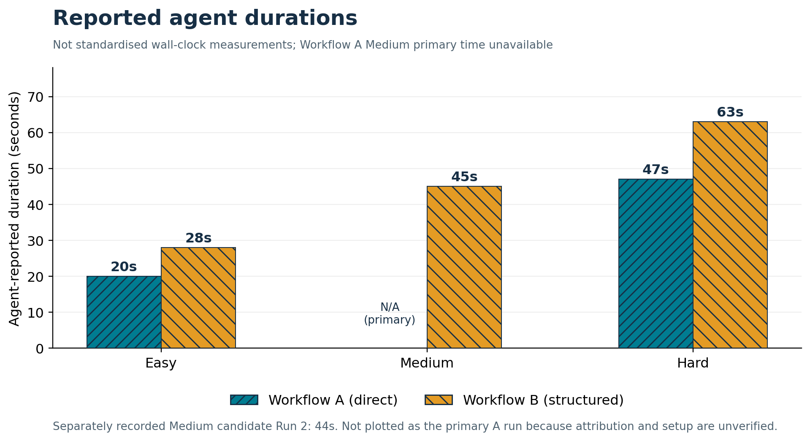

# AgentFlowBench | Updated experimental results and analysis

**Analysis date:** 18 October 2026  
**Study:** Direct vs structured coding-agent workflows on three buggy Python programs  
**Agent/model recorded in experiment logs:** OpenAI Codex CLI, GPT-6.1-Sol  
**Evidence:** Pytest outputs and user-authored agent activity logs supplied to the analysis  
**Status:** Pilot / exploratory study, not a general performance benchmark

## Executive summary

Across the **nine primary evaluations** (one original baseline plus two agent workflows for each of three tasks), the original buggy programs passed **27 of 80 tests (33.75%)**. Both Workflow A (direct) and Workflow B (structured) passed **80 of 80 tests (100%)**, improving on the baseline by **53 passing cases** and **66.25 percentage points**. Both workflow solutions passed the same cases: **the observed correctness difference between workflows is zero** on this suite.

These results demonstrate successful repair on the chosen problems, but **do not show structured prompting improves correctness**. Every agent solution reached the test suite ceiling, so differences in robustness outside these tests remain unknown. All agents attempted to invoke Python, but the Codex sandbox prevented runtime testing; independent Pytest was executed later outside the agent environment.

## 1. Research question and hypotheses

**Research question:** *How does direct versus explicitly structured workflow guidance influence a coding agent's functional correctness, observable development behaviour, and execution time when repairing buggy Python programs?*

- **Workflow A (Direct):** Give the task and constraints without prescribing a sequence of steps. The agent may choose its approach.
- **Workflow B (Structured):** Require an explicit sequence: analyse, identify issues, plan, implement, attempt tests, review, revise if needed.
- **Fixed context, as described in the experiment logs:** Same task description and target starting program intended for each corresponding primary pair, same model label, and sandbox restrictions on external Python execution.
- **Independent evaluation:** Target-specific Pytest suites (17 arithmetic, 24 shopping-cart, 39 booking cases). Original buggy source also tested to establish baseline.

The working hypothesis was that an explicit development process might improve correctness or reliability, particularly as task complexity increased. The observed test suite was not discriminating enough to confirm or reject a general form of this hypothesis.

## 2. Methods and reproducibility

| Dimension | Recorded setup / interpretation |
|:--|:--|
| Tasks | Easy: arithmetic (`math.py`); Medium: shopping cart (`cart.py`); Hard: room booking (`booking.py`) |
| Conditions | Original buggy code, Workflow A direct repair, Workflow B structured repair |
| Primary sample | One agent run per task and workflow: **six agent runs** plus three buggy baselines |
| Model | GPT-6.1-Sol, as entered in the activity logs |
| Source constraints | Agent instructed to modify its current task file and preserve the task specification |
| Agent testing | Python execution attempts failed within the Codex sandbox for all six primary agent runs |
| Independent testing | Python 3.13.14, pytest 9.1.1, as recorded in the test output headers |
| Primary metric | `passed / (passed + failed + errors) × 100` for a target-specific test suite |
| Timing fields | **Agent-reported duration** (not fully standardised), distinct from short **Pytest run duration** |
| Repeat evidence | A separate later Workflow A Medium Pytest output and Run 2 activity log (see Section 7) |

**Reproduction note:** The CSVs are reconstructed from uploaded logs. To reproduce the full experiment, preserve source snapshots, TASK.md, exact prompts, Codex version/model settings, evaluation test files, tool permission settings, and all tool-session traces. The uploaded logs alone do not prove byte-for-byte equivalence of input programs, particularly for the additional Medium run.

## 3. Primary correctness results

| Difficulty / task | Test cases | Original passed | Original pass rate | A passed | A pass rate | B passed | B pass rate | Improvement in passed cases per workflow |
|:--|--:|--:|--:|--:|--:|--:|--:|--:|
| Easy / arithmetic | 17 | 4 | 23.53% | 17 | 100% | 17 | 100% | +13 |
| Medium / cart | 24 | 7 | 29.17% | 24 | 100% | 24 | 100% | +17 |
| Hard / booking | 39 | 16 | 41.03% | 39 | 100% | 39 | 100% | +23 |
| **Total (test-case weighted)** | **80** | **27** | **33.75%** | **80** | **100%** | **80** | **100%** | **+53** |

> The aggregate counts sum test cases across three different tasks. They are descriptive; individual tests are not independent replicates of agent performance.

### Easy / arithmetic

The baseline passed 4/17 tests (including some degenerate zero cases) and failed 13. Both workflows corrected enough arithmetic and zero-division behaviour to pass all 17 independent tests. The test suite did not discriminate between a direct fix and a planned fix for this small, localised task.

### Medium / shopping cart

The baseline passed 7/24 and failed 17. Reported defect classes include the reversed quantity check, incorrect subtotal initialisation, incorrect discount calculation, price/quantity validation and item listing. Both primary solutions passed all 24 tests. The activity logs indicate different descriptions of process, **not** different measured correctness. The original first-run A Medium agent duration was not reliably measured.

### Hard / room booking

The baseline passed 16/39 and failed 23. Failure families cover malformed times and dates, booking-creation return values, overlap/adjacency boundary conditions, invalid intervals, duplicate IDs, cancellation, and filtering/sorting. Both agent workflows passed all 39 cases independently.

**Important interpretation:** The three labels Easy / Medium / Hard are task-design labels, not validated difficulty ratings. The higher baseline pass rate for Hard does not imply that Hard was easier; the test suites contain different cases and target different functionalities.

## 4. Detailed test-family breakdown

`test_family_summary.csv` gives the counts and baseline failure numbers for each parameterised test function. This is useful for describing where the original bugs appeared and which tested behaviours the agents restored. It does **not** estimate the probability of unseen defects.

**Observation:** Many baseline failures represent multiple inputs to the same underlying programming defect. For example, a bad subtotal calculation may cause several assertions to fail. Accordingly, **53 repaired test cases are not necessarily 53 distinct bugs**.

## 5. Agent behaviour and tool access

- **Both workflows attempted Python execution.** All six primary agents were blocked inside the sandbox, according to the activity logs. None had a successful runtime test before reporting completion.
- **Workflow B explicitly planned and reviewed**, as required by its prompts and described by its logs. No additional edits were observed or reported after final review on its documented runs.
- **Workflow A was allowed to choose its approach**; in the Medium primary run it attempted external Python execution, requested permission, and was denied. A failed permission request is observable behaviour, not an indicator of code correctness.
- **Agent-reported fixes versus independent proof:** Claims such as preserving APIs or having fixed each requirement are taken from activity logs. Functional correctness for tested behaviours is supported separately by Pytest output. Exact source diffs were not included in this latest upload bundle.

Workflow structure changed the documented **process**, but this suite showed no difference in functional pass rate. Because the agents could not run tests in the sandbox, the benefit of a real test-review-revise loop was not exercised.

## 6. Time and efficiency: descriptive only

| Difficulty | A: reported duration | B: reported duration | Difference (B − A) |
|:--|--:|--:|--:|
| Easy | 20 s | 28 s | +8 s |
| Medium, primary runs | Not reliably recorded | 45 s | Not calculable |
| Hard | 47 s | 63 s | +16 s |

For the **two tasks with paired reported durations**, B was 8 s and 16 s longer respectively. This is **not** evidence of a stable overhead without standardised wall-clock logging, repeated runs, and equivalent tool conditions. Agent duration is not the same thing as the Pytest duration (which is between 0.03 and 0.07 s on these successful logs). **Do not substitute the 44-second A Medium Run 2 value for the missing primary A Medium duration.**

## 7. Supplementary Medium Run 2: what is established?

The uploads contain **two distinct** Workflow A Medium Pytest reports:

| Pytest source | Result | Pytest execution time | Interpretation |
|:--|:--|--:|:--|
| `workflow_A_medium.txt` | 24/24 (100%) | 0.07 s | Earlier primary report |
| `workflow_A_medium(1).txt` | 24/24 (100%) | 0.05 s | Later report; candidate Run 2, attribution not independently verified |

The separately uploaded `agent_activity_log_work_A_medium(1).txt` explicitly labels a **Workflow A Medium Run 2**, reports **44 seconds** of agent time and describes additional work on `Decimal`, finite-value checks, mixed numeric types and a `_as_decimal` helper. It also says **the starting version's equivalence to the original buggy baseline was not verified**. The later Pytest output has no `run2` identifier, and the two reports both pass the *same* 24-case suite.

**Therefore:** The later 24/24 result is recorded in `supplementary_runs.csv` and not merged into the primary study. Even if it belongs to the intended Run 2, it does not establish that the numeric edge cases were tested, because the 24 original cases contain no additional `Decimal` robustness cases. If the trial is to count as a genuine repeat, save the original starting code checksum and an unambiguous `workflow_A_medium_run2.txt` alongside the prompt/session trace.

## 8. Main findings, meaning and limitations

1. **Direct vs structured correctness:** A and B tie at 100% for the 3 evaluated tasks. Their measured difference is **0 percentage points**.
2. **Comparison to baseline:** Each condition repairs a set of programs that collectively failed **53/80** of the original test cases. The source code was sufficiently repaired to pass the defined checks.
3. **Ceiling effect:** No headroom remains to detect an advantage between A and B on the current tests. A tougher or independent out-of-distribution suite may uncover differences, but is not part of these results.
4. **Timing trade-off unresolved:** B reports longer times for Easy and Hard, but not all durations are available or measured with a standard protocol.
5. **Sandbox constraint:** Neither workflow could complete runtime feedback or test-driven revision in its own environment. This may mask the value of structured execution on harder tasks.
6. **Threats to internal validity:** Agent-facing access to test files was restricted by instruction rather than guaranteed filesystem isolation; access was not independently audited. Same starting code and session state should be confirmed with hashes for future runs.
7. **Threats to external validity:** Only three small, self-contained Python tasks and one model were studied. One run per primary workflow-task combination provides no estimate of run-to-run variance. Task-specific test cases are not independent experimental replicates.
8. **Test coverage:** Passing all provided tests does not mean the implementation has no undiscovered bugs. Test oracles, ambiguous requirements, atypical numeric types, concurrency, error handling, and integration behaviour require additional targeted evaluation.

### Suggested interview conclusion

> “I built AgentFlowBench, a pilot environment for comparing direct and structured coding-agent workflows on controlled Python debugging tasks. Both workflows improved the combined independent test pass rate from 33.75% to 100%, so I found no measurable correctness advantage for explicit planning on this small benchmark. I did observe differences in the documented process and reported duration. Crucially, I recognised the ceiling effect and several validity limitations, including unstandardised timing, restricted agent-side Python execution, and a need to isolate evaluation tests. My next step would be replicated multi-file tasks with test execution enabled and pre-registered evaluation criteria.”

## 9. Follow-up experiment design

To distinguish the workflows, run **at least several independent repeats per workflow per task** with verified fresh copies (SHA-256), identical model versions and tool permissions, fresh sessions, isolated private tests, and a fixed token/time budget. Capture exact command timestamps and tool traces instead of relying on the agent's elapsed-time caption. Enable sandboxed Python in both conditions. Introduce multi-file refactoring, more intricate validation and regression tests, and assess correctness, regressions, test-generation quality, total cost, and recovery from failed tests. Decide success measures before running trials, then analyse results by matched task and workflow with uncertainty intervals rather than collapsing individual test assertions into pseudo-replicates.

## 10. Artifact and source index

| File | Contents |
|:--|:--|
| `results.csv` | Nine verified primary condition-by-task summaries (baseline/A/B × Easy/Medium/Hard) |
| `test_case_results.csv` | All **240** primary individual test outcomes (80 tests × 3 conditions) |
| `test_family_summary.csv` | Number passed/failed per test-function family, by task and condition |
| `workflow_process_observations.csv` | Agent behaviour summaries for the six primary agent trials |
| `supplementary_runs.csv` | Candidate A Medium Run 2, separately labelled and qualified |
| `supplementary_test_case_results.csv` | 24 additional outcomes in the candidate later Medium Pytest output |
| `source_manifest.csv` | Hashes, filenames and evidence roles of included source input logs |
| `*.png` | Six publication-ready charts with readable labels and differentiating patterns |
| `README.md` | Contents and guidance for importing this package into GitHub |

**Provenance:** Values are reconstructed from the uploaded plain-text Pytest and agent logs (not from public websites). All conclusions refer only to the recorded experiments, and newer supplemental files are not silently substituted for older primary measurements.
